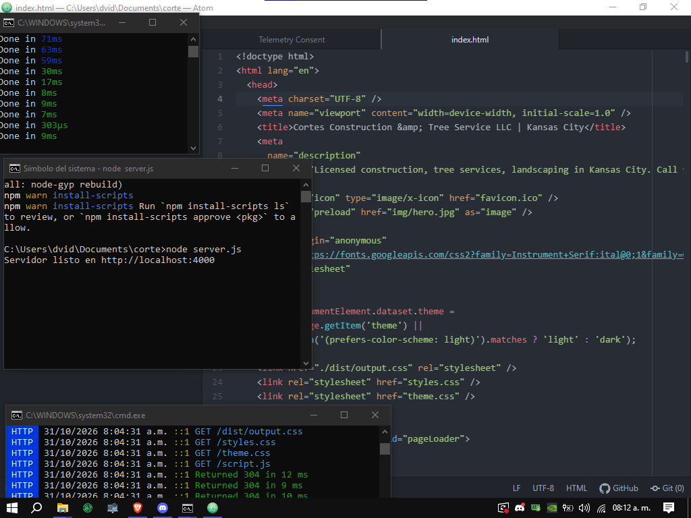

# cortes construction & tree service llc

pagina web para una empresa familiar de construccion, tree service y landscaping en kansas city. muestra los servicios, fotos de los trabajos, reviews, preguntas frecuentes y un formulario para pedir cotizaciones. las cotizaciones se guardan en una base de datos

## que hace la pagina

- tiene varias secciones: inicio, about, servicios, portafolio, antes y despues, reviews, faq y contacto
- se ve bien en celular y en pc (responsive)
- modo claro y modo oscuro con un boton en el menu, se acuerda de lo que elegiste
- carrusel de fotos que se mueve solo y da la vuelta infinita, se pausa si pasas el mouse
- antes y despues con flechas y puntos
- las fotos se piden al servidor con fetch (`GET /api/gallery`)
- formulario con validacion: campos obligatorios, telefono y correo con formato y mensajes de error
- el formulario se envia con js usando fetch (`POST /api/quotes`) y se guarda en la base de datos, ademas llega un aviso por correo con formspree
- cosas con el dom: cards de servicios que se abren, faq tipo acordeon, contadores animados, animaciones al hacer scroll

## como abrirlo

necesitas tener [node.js](https://nodejs.org) instalado

1. abre una terminal dentro de la carpeta del proyecto y corre esto (solo la primera vez):

```
npm install
npm install express better-sqlite3
```

2. en una terminal deja corriendo tailwind (genera `dist/output.css`):

```
npm run dev
```

3. en **otra** terminal inicia el servidor:

```
node server.js
```

4. si sale `Servidor listo en http://localhost:4000` ya esta, abre ese link en el navegador



> no abras el `index.html` con doble click, la pagina necesita el servidor para cargar las fotos y guardar las cotizaciones

## como se ven los formularios que manda la gente

cuando alguien llena el formulario y le da submit, se guarda en la base de datos (`quotes.db`). para verlos abre esto en el navegador mientras el servidor esta corriendo:

```
http://localhost:4000/api/quotes
```

sale una lista asi (la mas nueva primero):

```json
[
  {
    "id": 1,
    "name": "Ana Perez",
    "phone": "(913) 555-1234",
    "email": "ana@correo.com",
    "location": "Olathe",
    "services": "Mulch, Deck",
    "details": "quiero cambiar el mulch del frente y arreglar el deck",
    "created_at": "2026-10-31 13:20:00"
  }
]
```

si sale `[]` es que todavia no ha llegado ninguna. esa ruta solo funciona desde el mismo computador donde corre el servidor, desde otro dispositivo da error 403 (asi nadie mas ve los datos de los clientes)

## que hace cada archivo

| archivo | de que se encarga |
| ------- | ----------------- |
| `index.html` | la estructura de toda la pagina |
| `styles.css` | los estilos principales (colores, layout, animaciones, responsive) |
| `theme.css` | el modo claro, el boton de tema y mejoras de contraste |
| `script.js` | toda la logica del navegador: menu, carrusel, antes y despues, validacion y envio del formulario, fetch |
| `server.js` | el servidor con express: rutas get y post y conexion con la base de datos |
| `data.json` | los datos de las fotos del portafolio y del antes y despues |
| `quotes.db` | la base de datos sqlite con las cotizaciones (se crea sola) |
| `src/input.css` | archivo de entrada de tailwind |
| `dist/output.css` | css que genera tailwind (no se edita a mano) |
| `img/` | las imagenes del sitio |
| `favicon.ico` | el iconito de la pestana |
| `_headers` | config para hostings tipo netlify o cloudflare pages, en local no hace nada |
| `package.json` | lista de dependencias y comandos de npm |

## que se uso

- html, css y javascript
- tailwind css (se compila con npm)
- node.js y express para el servidor
- sqlite (con better-sqlite3) como base de datos
- formspree para el aviso por correo
- fetch para hablar con el servidor


## TENER EN CUENTA

- Fail message en form 
- Hacer partes del codigo en diferentes archivos seria genial
- mejorar modo claro y añadir custom color theme
- 
